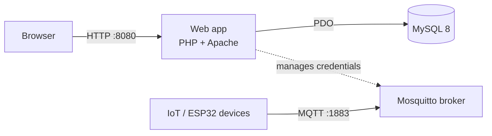

# MQTT Management Platform


A web-based management dashboard for an MQTT broker (Eclipse Mosquitto), built as my final project (Tugas Akhir) at Politeknik Negeri Kupang. It lets administrators manage users, broker credentials, and topic access for IoT and embedded systems from a browser instead of editing broker config files by hand.

The project is containerized with Docker, and every push is built and smoke-tested automatically with GitHub Actions.


**Final project title (Indonesian):** *Implementasi Server MQTT Berbasis Ubuntu 24 Untuk Mendukung Penerapan Teknologi Internet of Things dan Embedded System di Politeknik Negeri Kupang*

**Objectives**

- Provide a web interface for user management.
- Integrate MQTT communication for real-time data exchange.
- Fulfil a graduation requirement at Politeknik Negeri Kupang.

## Features

- Admin dashboard to approve, edit, and remove users
- Per-user MQTT credentials and topic assignments
- Registration, login, and logout flow
- Password reset by email (token-based, with expiry)
- Environment-based configuration (no secrets in the repository)
- One-command local stack with Docker Compose
- Automated CI: PHP syntax lint, image build, and full-stack smoke test

## Architecture



| Service     | Image / Stack            | Port (host) |
|-------------|--------------------------|-------------|
| `web`       | PHP 8.3 + Apache         | 8080        |
| `db`        | MySQL 8.0                | internal    |
| `mosquitto` | eclipse-mosquitto:2      | 1883        |

## Tech stack

PHP, Composer (vlucas/phpdotenv, PHPMailer), MySQL, Eclipse Mosquitto, Docker, Docker Compose, GitHub Actions.

## Getting started

### Prerequisites

- Docker and Docker Compose
- Git

### Run with Docker Compose

```bash
git clone https://github.com/JuanSalmon/TA.git
cd TA

cp .env.example .env
# edit .env and set your own values (use strong, unique passwords)

docker compose up --build
```

Then open <http://localhost:8080>.

To stop and remove everything, including database data:

```bash
docker compose down -v
```

> The database schema in `database/schema.sql` is loaded automatically the first time the database volume is created. It contains structure only, no data.

### Run without Docker (development)

```bash
cd app
composer install
cp .env.example .env     # fill in your database and SMTP settings
php -S localhost:8000
```

This requires PHP 8.3 and a MySQL/MariaDB database loaded with `database/schema.sql`.

### Configuration

All settings are read from environment variables (see `.env.example`):

| Variable | Description |
|----------|-------------|
| `DB_NAME`, `DB_USER`, `DB_PASS` | Database name and credentials |
| `SMTP_HOST`, `SMTP_PORT`, `SMTP_USERNAME`, `SMTP_PASSWORD` | Mail server used for password reset |
| `SMTP_FROM_EMAIL`, `SMTP_FROM_NAME` | Sender shown on reset emails |
| `APP_URL` | Public base URL used to build reset links |

## Project structure

```
.
├── app/                    # PHP application (admin, user, login, mqtt, config, ...)
├── database/schema.sql     # Database structure (no data)
├── docker/
│   ├── Dockerfile          # PHP + Apache + Composer image
│   └── mosquitto/          # Mosquitto configuration
├── docker-compose.yml      # web + MySQL + Mosquitto
├── .github/workflows/      # CI pipeline
└── .env.example            # Example environment variables
```

## CI pipeline

The workflow in `.github/workflows/ci.yml` runs on every push to `testing` and `master`, and on pull requests:

1. **Lint**: checks the syntax of all PHP files.
2. **Smoke test**: builds the image, starts the full stack with Docker Compose, verifies the login page responds over HTTP and the MQTT broker port is open, then tears everything down.

## Security notes

- Secrets are never committed. `.env` is git-ignored; only `.env.example` is tracked.
- `database/schema.sql` contains structure only.
- The bundled Mosquitto configuration allows anonymous connections **for local development only**. Do not expose it to the internet as is.

## Roadmap

- [ ] Build and publish the image to GitHub Container Registry
- [ ] Harden Mosquitto: password file, ACLs, and TLS on port 8883
- [ ] Infrastructure as Code with Terraform
- [ ] Server configuration with Ansible
- [ ] Monitoring with Prometheus and Grafana
- [ ] Store MQTT credentials securely (hashed or encrypted)

## Contributing

1. Fork this repository.
2. Create a feature branch: `git checkout -b your-feature`
3. Commit your changes: `git commit -m "Add feature X"`
4. Push the branch: `git push origin your-feature`
5. Open a Pull Request on GitHub.

<!-- ## License

MIT License. See the `LICENSE` file for details. -->

## Author and contact

Juan Filbert William Salmon, Computer and Network Engineering graduate, Politeknik Negeri Kupang.

Email: juanfilbert1122@gmail.com
